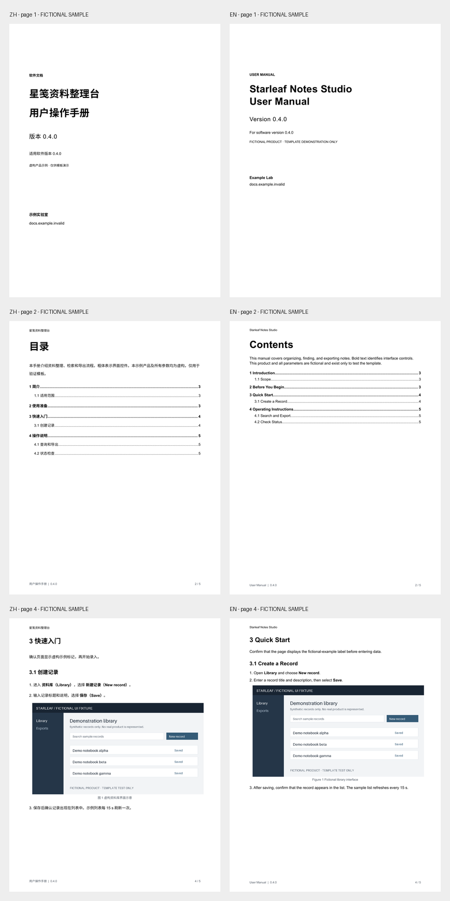

# Bilingual Product Manual Skill

可分享的 Codex 技能：从用户现有产品资料生成同版式的中英文软件操作手册，包含可编辑 DOCX、PDF 与渲染校验。

- [安装与调用](bilingual-product-manual/README.md)
- [技能入口](bilingual-product-manual/SKILL.md)
- [固定样式与可配置边界](bilingual-product-manual/references/style-contract.md)
- [输入 schema](bilingual-product-manual/references/input.schema.json)
- [虚构输入示例](bilingual-product-manual/examples/fictional-product.json)
- [验收记录](validation/report.md)

把 `bilingual-product-manual` 子目录完整复制到 Codex 的 skills 目录，然后输入：

> 使用 $bilingual-product-manual，根据我提供的产品资料生成中英文操作手册，缺资料处只在内部报告中记录。

固定版式为 Letter 纵向、黑白标题、层级目录、步骤配截图、运行页眉与连续页码。仅提供软件操作手册模板；硬件彩页与规格书没有混入。

样张全部虚构：

| 语言 | 编辑文件 | 阅读文件 |
| --- | --- | --- |
| 中文 | [DOCX](samples/manual-zh.docx) | [PDF](samples/manual-zh.pdf) |
| English | [DOCX](samples/manual-en.docx) | [PDF](samples/manual-en.pdf) |

仓库不含原始业务文档、原截图、公司 Logo、真实联系人、凭据或本机绝对路径。引用的字体不随包分发。当前验收环境为 macOS ARM64；路径搬迁测试通过，其他操作系统需再验证渲染。源码复用许可由仓库所有者另行决定。
