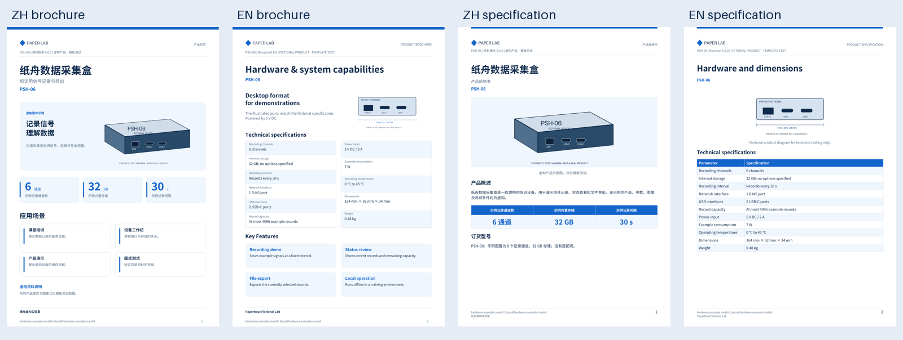

# Bilingual Product Manual Skill · v2.0.0

从现有资料生成同版式的中英文产品文档，**以硬件彩页和产品规格书为重点**，同时保留独立的软件操作手册模板。

| 可选模板 | 固定风格 | 成品 |
| --- | --- | --- |
| `hardware-brochure` | A4 蓝白双页：产品图、指标卡片、场景、等高双栏参数、卖点 | 中英 PDF |
| `hardware-specification` | A4 蓝白：产品概述、结构、分组参数、可选性能及应用 | 中英可编辑 DOCX / PDF |
| `software-manual` | Letter 黑白：封面、层级目录、步骤截图、页眉页码 | 中英可编辑 DOCX / PDF |

- [安装与调用](bilingual-product-manual/README.md) / [技能入口](bilingual-product-manual/SKILL.md)
- [硬件样式契约](bilingual-product-manual/references/hardware-style-contract.md) / [输入 schema](bilingual-product-manual/references/hardware-input.schema.json) / [虚构示例](bilingual-product-manual/examples/fictional-hardware.json)
- [软件样式契约](bilingual-product-manual/references/style-contract.md) / [软件输入](bilingual-product-manual/references/input-guide.md)
- [v2 完整验收](validation/report.md) / [独立硬件前向测试](validation/hardware-forward/forward-report.md) / [v1 软件历史验收](validation/report-v1-software.md)

把整个 `bilingual-product-manual` 子目录复制到 Codex 的 skills 目录，在新会话调用：

> 使用 $bilingual-product-manual，根据我提供的硬件资料制作中英文彩页和产品规格书，保持模板样式；核对产品图片与参数，缺资料只记入内部清单，不编造。

所有样张、参数、品牌和示意图均明确虚构：

| 类型 | 中文 | English |
| --- | --- | --- |
| 硬件彩页（各 2 页） | [PDF](samples/hardware/brochure-zh.pdf) | [PDF](samples/hardware/brochure-en.pdf) |
| 硬件规格书（各 4 页） | [DOCX](samples/hardware/specification-zh.docx) / [PDF](samples/hardware/specification-zh.pdf) | [DOCX](samples/hardware/specification-en.docx) / [PDF](samples/hardware/specification-en.pdf) |
| 软件操作手册（各 5 页） | [DOCX](samples/manual-zh.docx) / [PDF](samples/manual-zh.pdf) | [DOCX](samples/manual-en.docx) / [PDF](samples/manual-en.pdf) |

不包含原业务文档、原产品图片、真实 Logo/联系人、凭据或本机绝对路径。字体由使用者合法安装，不随包分发。本次验收为 macOS ARM64，包含新目录搬迁测试；其他机器与操作系统需重新验收。源码复用许可由仓库所有者另行决定。
